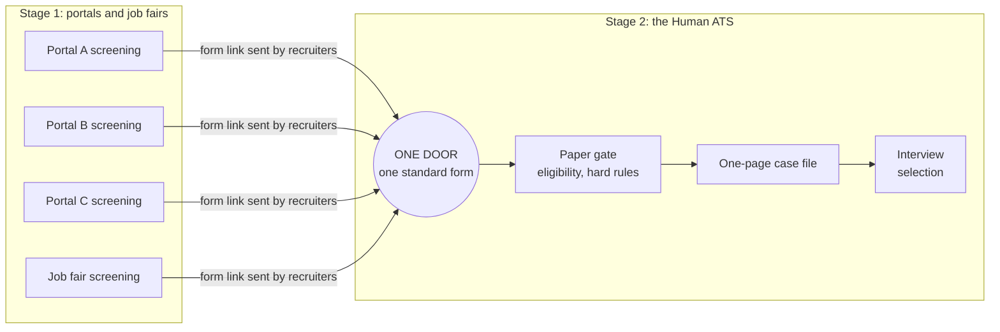
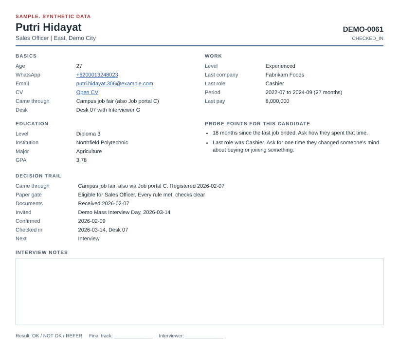
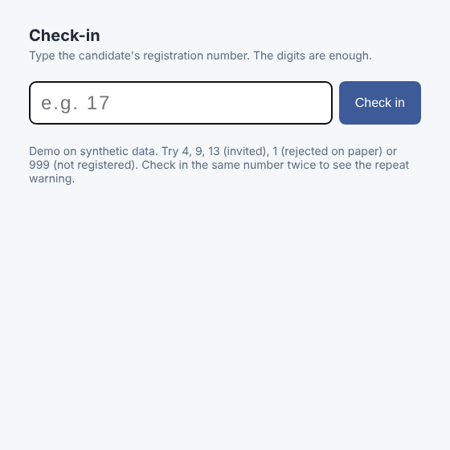
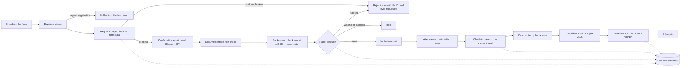

# Recruitment Front Door

**One door for every screened candidate, then a "Human ATS" that works like a visa office.** Candidates passed first screening on many job portals. All of them then came through one standard form. Fixed rules settled eligibility on paper. Each eligible candidate got a one-page case file, and the interview made the selection.

> I designed and ran this system at a bank in Indonesia. This is a rewrite from scratch with synthetic data. No original code, data or templates are included.



**In production:** 10,000+ CVs a year came through the one door. We ran daily online interview sessions of 40 to 50 candidates, plus multi-city mass interview events.

**What this repo can and can't show:** it rebuilds how the system worked, module by module, and tests each rule. It can't re-measure results from the real operation, because the data here is synthetic.

---

## The problem sat after the portals

This system starts after sourcing. Each job portal ran its own first screening. The trouble started when those screened candidates had to enter the hiring operation:

- Every portal handed candidates over in its own export format.
- Recruiters re-typed each one into trackers before anyone could act.
- The same person could pass screening on two portals and show up twice.
- Eligibility was judged by reading CVs, and interviews ran from a generic script.

## The design

### One door

Recruiters sent every screened candidate, from every portal, the same form link. The form asked which portal they came through. From that point on there was one record shape, one ID per person, and one place to look. A person who registered twice through two portals was caught at the door and kept one record. The extra portal was noted on it.

Here is the same synthetic candidate as two portals would have handed him over ([full before and after files](sample/before-after/)):

| | Name | Contact | Birth | Education |
|---|---|---|---|---|
| Portal A export | `FAJAR PRATAMA` | `+62 000-8272-2813`, email ending .168 | `04/01/1986` | `DIPLOMA 3` |
| Portal C export | `Fajar Pratama` | email ending .180 / `0000 8272 2813` | age `40` only | `D3 / Associate` |
| **After the door** | **DEMO-0039**, Fajar Pratama | one WhatsApp number, `6200082722813` | `1986-01-04` | `Diploma 3` |

His two emails differ, but his WhatsApp number, name and birth date match, so the door treated him as one person. His second registration (DEMO-0172) points to DEMO-0039 and gets no emails of its own ([door.ts](src/core/door.ts), [door.test.ts](tests/door.test.ts)).

### The Human ATS: four steps, like a visa office

A visa office handles huge volume with a small staff, and it still treats each applicant as a case. I borrowed its shape.

| Step | Visa office | This system | Module |
|---|---|---|---|
| 1 | One standard application form | The one door. Every screened candidate fills the same structured form | [door](src/core/door.ts), [IDs](src/core/ids.ts) |
| 2 | The file is checked against fixed requirements | **Eligibility on paper.** Hard rules decide who may be interviewed. No one can override them, however strong the candidate looks | [screening gate](src/core/screening.ts), [status rules](src/core/status.ts) |
| 3 | The officer reads a standard case file | **One-glance case file.** Each candidate's answers become the same one-page card, so an interviewer can review about 10 at a glance | [candidate card](src/core/card.ts) |
| 4 | The interview decides | **Selection at the interview.** The card lists probe points from this candidate's own record. There is no fixed question script | [probe points](src/core/card.ts) |

Most eligibility outcomes are known before anyone meets the candidate. Interview time goes to choosing among people who already qualify.

### Hard rules are requirements, applied the same way to everyone

The rules are the role's requirements as set by the business and by banking regulation, such as minimum education per track and background checks. In the rebuild they live on a Tracks tab, not in code. The system's job is to apply them the same way every time, so no recruiter has to make an exception call, and no candidate is turned down for a reason nobody can name.

In code there is one status column, and it can only move along fixed edges. `PAPER_REJECT` has no way out:

```ts
// PAPER_REJECT has no way out. That is the rule the whole design rests on:
// a hard-rule rejection cannot be reversed by someone who likes the candidate.
PAPER_REJECT: [],
```

Every change the code makes goes through these rules ([status.test.ts](tests/status.test.ts)). Staff type some statuses by hand, such as interview results. An edit check covers those. An illegal move, like a paper rejection straight to INVITED, reverts, and the row says why. A status pasted as a block can't be checked this way, so the row is flagged and staff change it one cell at a time. Changing a rule on the Tracks tab only affects candidates who are still undecided, so the rules don't shift halfway through a hiring round.

### A decision trail for every candidate

Anyone can open a candidate and see where they came from, what the paper gate decided and why, and what happens next ([trail.ts](src/core/trail.ts)). A synthetic rejection reads like this:

> **Paper gate:** Not eligible for Sales Officer. High school is below the Diploma 3 minimum for Sales Officer. Age 46 is outside 20 to 30 for Sales Officer

### The case file

The card puts the form answers, the decision trail and the probe points on one page. The [PDF version](sample/candidate-card-sample.pdf) has working WhatsApp, email and CV links.



This candidate came through a campus job fair and registered again through Job portal C. Both are on one record. The probe points come from her own history. Her last job ended 18 months ago, and her last role was a cashier, applying for a sales track. Those are questions only she gets. A file with no flags still gets one prompt: pick a line of the work history and ask for a concrete example.

### Why Google Sheets

The team had to run this without me. The system already ran on Google Forms, Sheets and Apps Script, and a sheet is something everyone on the team could open. Apps Script added what a sheet can't do on its own: locking, emails, triggers, a check-in panel and PDF export. The team kept running the system after I left. At a larger scale I would move the records to a database with access tiers and a retention policy. The logic in `src/core` has no Google dependency, so it would carry over unchanged.

---

## Event day and the rest of the loop

The door and the gate are the core. The same engine also ran everything after the invitation, so nobody got lost between registration and offer.





| Module | What it does | Tested in |
|---|---|---|
| One door | Matches a repeat registration from another portal to the first one, by email, WhatsApp number, or name plus birth date. Notes the extra portal on the first record | [door.test.ts](tests/door.test.ts) |
| Intake + ID | Assigns `PREFIX-0001` IDs under a document lock, so two submissions in the same second never share an ID. Accepts any shape staff type (`17`, `DEMO017`, `demo-0017`) | [ids.test.ts](tests/ids.test.ts) |
| Screening gate | Applies each track's hard rules and records which ones failed. Waits for missing checks rather than guessing. A check that comes back flagged after the invitation still rejects before the interview. An unknown education value is an error, never a silent rejection | [screening.test.ts](tests/screening.test.ts) |
| Notifications | Works out which email each candidate is owed from their status and a send log. 20 per run, stops before the daily mail quota runs out, picks up the rest next run | [notify.test.ts](tests/notify.test.ts) |
| Document intake | Matches emailed documents to a registration by the ID in the subject and the sender address. Checks file types. Logs each message once | [intake.test.ts](tests/intake.test.ts) |
| Background check match | Applies a result only when the ID **and** the name agree, so one mistyped ID can't attach a flag to the wrong person | [intake.test.ts](tests/intake.test.ts) |
| Attendance + check-in | Candidates confirm with the digits of their ID. On the day, a check-in panel inside the sheet greets them and tells them their colour tag and seating area | [event.test.ts](tests/event.test.ts) |
| Desk router | Seats each candidate with an interviewer from their home area, balancing load and keeping existing seats. When area desks are full, it uses the any-area desks. Splits online days into sessions of up to 50 on a Sessions tab | [event.test.ts](tests/event.test.ts) |
| Candidate card + PDF | One-page card with working WhatsApp, email and CV links. Exports one PDF per candidate, for a single candidate or everyone at a desk, into a folder only the hiring team can open | [event.test.ts](tests/event.test.ts) |
| Decision trail | Source portal, paper decision with reasons, dates and next step for each candidate. Printed on the card | [door.test.ts](tests/door.test.ts) |
| Funnel monitor | Stage counts and conversion, counted per person. Also by portal, by rejection reason, and how many repeat registrations the door caught, plus a countdown to the event | [funnel.test.ts](tests/funnel.test.ts) |

The tests run on every push. The Apps Script layer is tested too. [gas-flow.test.ts](tests/gas-flow.test.ts) runs the built bundle against fake Sheets, Mail and Lock services. It covers a fresh event from registration to desk assignment, including the mail quota running out halfway, date cells, the attendance form and a hand-typed illegal status. A fake can't catch everything real Google services do, so the first live run still needs a test event.

---

## What the rebuild fixes

The original ran for several hiring seasons. Over that time the recruitment SLA dropped about 80% and admin work about 60%. A review of its sheets and scripts also found specific weak spots. The rebuild fixes those.

| In the original | In this rebuild |
|---|---|
| Scripts addressed columns by number. Adding one form question shifted everything | Columns are found by header name ([headers.ts](src/core/headers.ts)). A missing header fails loudly at setup |
| Decision emails fired from an edit trigger that likely read only the top row of an edit. Pasting a block of decisions could reach just one person | A sender job checks every row each run. The send log makes it safe to rerun ([notify.test.ts](tests/notify.test.ts) pastes 30 at once) |
| Two ID formats ended up in use side by side | One format. Every input is parsed back to it |
| Progress was spread over several free-text columns | One status column with fixed allowed moves |
| Each city event ran on its own set of forms and sheets | Event details, tracks and desks live on Config, Tracks and Desks tabs |
| Candidate card PDFs went to a folder shared by link | The cards folder keeps its own sharing. Share it with the hiring team only. The code never makes a file public |

The design choices behind these fixes, with what each one gives up, are in [DECISIONS.md](DECISIONS.md). Where each claim in this README comes from is in [evidence.md](evidence.md).

## What's next

- One live test event on a real sheet. Gmail inbox mode and the real PDF export call can't be tested on fakes.
- At a larger scale, move the records to a database with access tiers and a retention policy. `src/core` carries over unchanged.

## Run it

**Look without installing:** download the [check-in demo](docs/demo/index.html) and open it in a browser, or see the [sample card PDF](sample/candidate-card-sample.pdf) and the [synthetic registrations](sample/registrations.csv).

**Run the tests**

```bash
npm install
npm run build   # bundles src/gas into dist/Code.js for Apps Script
npm run seed    # regenerates the synthetic event in sample/
npm test
```

**Put it on a real spreadsheet**

1. Create a Google Sheet. Link the registration form to it and name its response tab `Registrations`. The form questions are listed in [src/gas/sheet.ts](src/gas/sheet.ts) (`FORM_FIELDS`).
2. Link a second, short form with one question, "Registration number". Name its response tab `Attendance Confirmations`.
3. `npx clasp login`, then copy `.clasp.json.example` to `.clasp.json` with your script ID, then `npm run push`.
4. Reload the sheet. From the **Front Door** menu, run **Create missing tabs**. It adds the system columns to Registrations and creates the other tabs.
5. Fill in Config, Tracks and Desks. The CSVs in `sample/` are a working starting point.
6. Run **Setup triggers** once.
7. On event day, open **Check-in panel** from the menu on the check-in desk laptop. It runs inside the sheet, so only people the sheet is shared with can use it.

Inbox mode `MOCK` reads the Mock Inbox tab, so you can try document intake without touching Gmail.

## Repo map

```
src/core/     pipeline logic, no Google dependency, fully unit tested
src/gas/      Apps Script layer: sheet adapter, entry points, card PDF export
src/html/     email templates and the check-in page
scripts/      build, synthetic data seed, sample card and demo builders
sample/       synthetic event: 400 registrations, config, tracks, desks, mock inbox, before/after door files
docs/         demo page, GIF, card image
tests/        unit tests plus the Apps Script flow test
```

## Data note

Everything in this repo is synthetic and made by `scripts/seed.ts` with a fixed seed. Names are random pairs of common first and last names. Emails use `example.com`. Phone numbers start with `0000`, so they can't reach anyone. There are no ID card numbers or ID images at all. Funnel ratios are invented and do not reflect any real event. The portal export layouts in `sample/before-after/` are invented to show typical differences. They don't copy any real portal's format.
